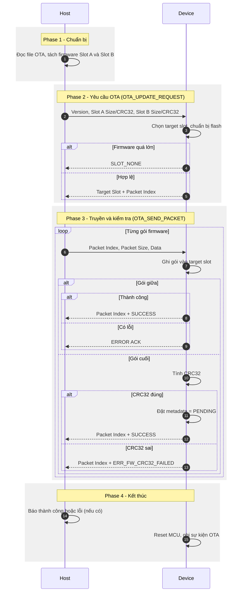

# OTA (Over-The-Air)

## 1. Tổng quan

OTA (Over-The-Air) là cơ chế cập nhật firmware cho thiết bị thông qua giao tiếp RS485 hoặc mạng di động 4G, không cần sử dụng thiết bị nạp firmware chuyên dụng.

Firmware mới được tải về và ghi vào vùng Flash không chứa firmware đang chạy. Sau khi tải hoàn tất, hệ thống kiểm tra tính toàn vẹn của firmware bằng CRC32.

Hệ thống sử dụng cơ chế hai vùng firmware (Dual-Slot) gồm:
- **Slot A:** Vùng lưu trữ firmware A.
- **Slot B:** Vùng lưu trữ firmware B.

Tại một thời điểm, thiết bị chỉ thực thi firmware từ một slot. Slot còn lại được sử dụng để lưu firmware mới trong quá trình OTA.

## 2. Cấu trúc bộ nhớ FLASH

Hệ thống sử dụng hai slot độc lập để lưu trữ firmware. Firmware mới luôn được tải vào slot không chứa firmware đang chạy.

Các địa chỉ vùng nhớ được xác định thông qua các macro cấu hình trong firmware ở file `flash_layout.h`:

| Địa chỉ vùng nhớ | Macro | Dung lượng | Chức năng |
|---|---|---|---|
| `0x08000000` | `BOOTLOADER_START_ADDR` | 32.752 bytes | Lưu trữ chương trình Bootloader, thực hiện kiểm tra và quản lý quá trình khởi động, lựa chọn slot app để thực thi |
| `0x08007FF0` | `BOOTLOADER_VERSION_ADDR` | 16 bytes | Lưu trữ thông tin phiên bản Bootloader |
| `0x08008000` | `SLOT_A_METADATA_ADDR` | 2.048 bytes (2 kB) | Lưu trữ metadata của firmware Slot A, bao gồm phiên bản, kích thước, CRC32, sequence và trạng thái firmware |
| `0x08008800` | `SLOT_A_START_ADDR` | 112.640 bytes (110 kB) | Vùng lưu trữ firmware Slot A |
| `0x08024000` | `SLOT_B_METADATA_ADDR` | 2.048 bytes (2 kB) | Lưu trữ metadata của firmware Slot B, bao gồm phiên bản, kích thước, CRC32, sequence và trạng thái firmware |
| `0x08024800` | `SLOT_B_START_ADDR` | 112.640 bytes (110 kB) | Vùng lưu trữ firmware Slot B |

## 3. Quản lý firmware

Ở bộ nhớ FLASH, vùng metadata ở mỗi slot được lưu dưới dạng cấu trúc `Firmware_Metadata_t` ở địa chỉ `SLOT_A_METADATA_ADDR` và `SLOT_B_METADATA_ADDR` tương ứng cho mỗi slot firmware. Metadata lưu trong FLASH gồm các nội dung được sắp xếp theo thứ tự:
- `[0-3]` (`uint32_t` - 4 bytes): Số thứ tự Metadata được tăng thêm 1 khi khởi tạo Metadata cho một phiên cập nhật firmware mới. Bootloader sử dụng thông tin này kết hợp với trạng thái firmware để xác định slot firmware được ưu tiên thực thi.
- `[4-15]` (`uint8_t[]` - 12 bytes ASCII): Lưu phiên bản firmware tương ứng với slot.
- `[16-19]` (`uint32_t` - 4 bytes): Lưu trạng thái firmware hiện tại ở slot tương ứng (`0x00`: `FIRMWARE_VALID` ; `0x01`: `FIRMWARE_INVALID`; `0x02`: `FIRMWARE_UPDATING`; `0x03`: `FIRMWARE_PENDING`).
- `[20-23]` (`uint32_t` - 4 bytes): Kích thước firmware image (byte).
- `[24-27]` (`uint32_t` - 4 bytes): Giá trị CRC32 dùng để kiểm tra tính toàn vẹn firmware.
- `[28-29]` (`uint16_t` - 2 bytes): Số lượng packet firmware đã tải xuống, được sử dụng để xác định vị trí tiếp tục tải.

## 4. Giao thức OTA
Giao thức OTA sử dụng cấu trúc frame tiêu chuẩn của hệ thống (quy định tại `protocol.md`) với **CMD = 0x05 (CMD_OTA)**. Tất cả các trường multi-byte đều được truyền dưới dạng Little-Endian (LE).

Lệnh `CMD_OTA` gồm hai ID định nghĩa bởi `Protocol_Ota_Id_Code_t`:

- `0x00` (`OTA_UPDATE_REQUEST`): Yêu cầu cập nhật firmware.
- `0x01` (`OTA_SEND_PACKET`): Gửi gói tin cập nhật xuống thiết bị.

### 4.1. OTA_UPDATE_REQUEST (0x00)

Để yêu cầu thiết bị cập nhật firmware, Payload gửi xuống thiết bị phải chứa các trường dữ liệu theo thứ tự như sau:
- `[0-9]` (10 bytes ASCII): Version của firmware yêu cầu cập nhật.
- `[10-13]` (`uint32_t` - 4 bytes): Dung lượng firmware slot A.
- `[14-17]` (`uint32_t` - 4 bytes): CRC32 của firmware slot A.
- `[18-21]` (`uint32_t` - 4 bytes): Dung lượng firmware slot B.
- `[22-25]` (`uint32_t` - 4 bytes): CRC32 của firmware slot B.

Sau khi nhận được yêu cầu, thiết bị sẽ gửi lại bản tin có Payload như sau:
- `[0]` (1 byte): Firmware slot thiết bị yêu cầu (`0x00`: Dung lượng không đủ; `0x01`: Yêu cầu slot A; `0x02`: Yêu cầu slot B).
- `[1-2]` (`uint16_t` - 2 bytes): Yêu cầu cập nhật từ gói tin thứ `n` (Nếu cập nhật từ đầu thì `n=0`).

**Ví dụ:**

Thiết bị nhận yêu cầu cập nhật:
- Firmware version: `V1.1.5`.
- Dung lượng Slot A: `58880` bytes.
- CRC32 Slot A: `0xFB7A7AD1`.
- Dung lượng Slot B: `58880` bytes.
- CRC32 Slot B: `0x4FC0C0D5`.

Thiết bị phản hồi yêu cầu cập nhật:
- Yêu cầu tải firmware vào Slot B.
- Bắt đầu tải từ packet index `0`.

```text
[Host->Device] 56 31 2E 31 2E 35 00 00 00 00 00 E6 00 00 D1 7A 7A FB 00 E6 00 00 D5 C0 C0 4F
[Device->Host] 02 00 00
```

### 4.2. OTA_SEND_PACKET (0x01)

Gói tin trong firmware được phân chia thành mỗi gói 1024 bytes (1 kB) và sẽ được gửi lần lượt xuống thiết bị. Đến gói cuối cùng nếu không đủ 1024 bytes thì gửi nốt phần còn lại. Payload gửi gói tin xuống thiết bị được sắp xếp như sau:
- `[0-1]` (`uint16_t` - 2 bytes): Số thứ tự của gói tin.
- `[2-3]` (`uint16_t` - 2 bytes): Dung lượng của gói tin (tối đa `1024`).
- `[4-n]` (`uint8_t[]`): Dữ liệu ghi vào FLASH.

Sau khi nhận được gói tin, thiết bị sẽ gửi bản tin phản hồi có payload như sau:
- `[0-1]` (`uint16_t` - 2 bytes): Số thứ tự của gói tin.
- `[2]` (`uint8_t` - 1 byte): Mã kết quả xử lý (`0x00`: Thành công, dữ liệu đã được ghi vào FLASH. Nếu là gói tin cuối cùng, firmware đã được kiểm tra CRC32 thành công và quá trình tải firmware hoàn tất; `0x05`: CRC32 của firmware không khớp).

**Ví dụ:**

Thiết bị nhận được gói tin thứ `5` có dung lượng `1024` bytes với nội dung `CA 59 60 04 ... 15 46`. Thiết bị nhận được và ghi vào FLASH thành công.

```text
[Host->Device] 05 00 00 04 CA 59 60 04 ... 15 46
[Device->Host] 05 00 00
```

## 5. Quy trình cập nhật Firmware dành cho PC Tool/Server

File firmware OTA chứa thông tin metadata và dữ liệu firmware của hai slot A và B. PC Tool và Server sử dụng chung định dạng file và quy tắc xử lý để đọc, kiểm tra tính hợp lệ và trích xuất dữ liệu firmware.

### 5.1. Cấu trúc dữ liệu trong file

File firmware OTA được chia thành các vùng dữ liệu như sau:

| Vùng dữ liệu | Offset trong file | Nội dung |
|---|---:|---|
| Metadata Slot A | `0x00000` | Thông tin firmware của Slot A |
| Firmware Slot A | `0x00800` | Dữ liệu firmware của Slot A |
| Metadata Slot B | `0x1C000` | Thông tin firmware của Slot B |
| Firmware Slot B | `0x1C800` | Dữ liệu firmware của Slot B |

Các offset được tính tương đối từ đầu file firmware OTA, tương ứng với địa chỉ Flash của thiết bị sau khi trừ đi địa chỉ bắt đầu vùng Slot A (`0x08008000`).

### 5.2. Đọc Metadata

Metadata của mỗi slot được đọc tại offset tương ứng trong file OTA, theo cấu trúc dữ liệu đã mô tả tại mục [3. Quản lý firmware](#3-quản-lý-firmware).

Trong quá trình xử lý, PC Tool/Server chỉ cần sử dụng các trường thông tin chính của mỗi slot, bao gồm:

- **Firmware Version:** Phiên bản firmware.
- **Firmware Size:** Kích thước dữ liệu firmware.
- **Firmware CRC32:** Giá trị CRC32 của dữ liệu firmware.

**Chú ý:** Trường **Firmware Size** và trường **Firmware CRC32** được lưu trong file `*.bin` dưới dạng Little-Endian.

### 5.3. Kiểm tra và trích xuất Firmware

Sau khi đọc Metadata, PC Tool/Server thực hiện kiểm tra tính hợp lệ của dữ liệu firmware trong từng slot bằng cách tính toán CRC32 trên vùng dữ liệu firmware tương ứng và so sánh kết quả với giá trị Firmware CRC32 được lưu trong Metadata.

Vị trí bắt đầu và kích thước dữ liệu firmware của mỗi slot được xác định như sau:

| Firmware | Offset bắt đầu | Kích thước dữ liệu |
|---|---:|---|
| Slot A | `0x00800` | Theo trường `Firmware Size` của Metadata Slot A |
| Slot B | `0x1C800` | Theo trường `Firmware Size` của Metadata Slot B |

Thuật toán CRC32 thiết bị sử dụng được mô tả bằng đoạn code python như sau:

```python
def crc32(data: bytes, init: int = 0xFFFFFFFF) -> int:
    poly = 0x04C11DB7
    crc = init & 0xFFFFFFFF

    def crc_word_update(crc_val: int, word: int) -> int:
        crc_val ^= word & 0xFFFFFFFF

        for _ in range(32):
            if crc_val & 0x80000000:
                crc_val = ((crc_val << 1) ^ poly) & 0xFFFFFFFF
            else:
                crc_val = (crc_val << 1) & 0xFFFFFFFF

        return crc_val

    n = len(data)
    i = 0

    while i + 4 <= n:
        word = (
            (data[i] << 24)
            | (data[i + 1] << 16)
            | (data[i + 2] << 8)
            | data[i + 3]
        )

        crc = crc_word_update(crc, word)
        i += 4

    rem = n - i

    if rem:
        b0 = data[i] if rem >= 1 else 0
        b1 = data[i + 1] if rem >= 2 else 0
        b2 = data[i + 2] if rem >= 3 else 0

        word = (b0 << 24) | (b1 << 16) | (b2 << 8)
        crc = crc_word_update(crc, word)

    return crc & 0xFFFFFFFF
```

**Chú ý:** File firmware OTA chỉ được xem là hợp lệ khi trường Firmware Version trong Metadata của cả hai slot A và B có giá trị giống nhau. Và cả hai giá trị CRC32 trong metadata đều hợp lệ.

### 5.4. Chia gói tin Firmware

Sau khi hoàn tất quá trình kiểm tra và xác nhận file OTA hợp lệ, PC Tool/Server gửi bản tin yêu cầu cập nhật firmware đến thiết bị.

Căn cứ vào thông tin Firmware Slot do thiết bị phản hồi, PC Tool/Server xác định Metadata tương ứng và sử dụng trường `Firmware Size` để xác định tổng số byte dữ liệu cần truyền.

Dữ liệu firmware được chia thành các gói tin có kích thước tối đa 1024 bytes. Riêng gói tin cuối cùng có thể có kích thước nhỏ hơn 1024 bytes nếu tổng kích thước firmware không chia hết cho 1024.

Các gói tin được đánh số thứ tự bắt đầu từ 0 và dữ liệu được đọc tuần tự từ offset bắt đầu của firmware tương ứng cho đến khi truyền đủ số byte theo trường `Firmware Size`.

## 6. Quá trình OTA

